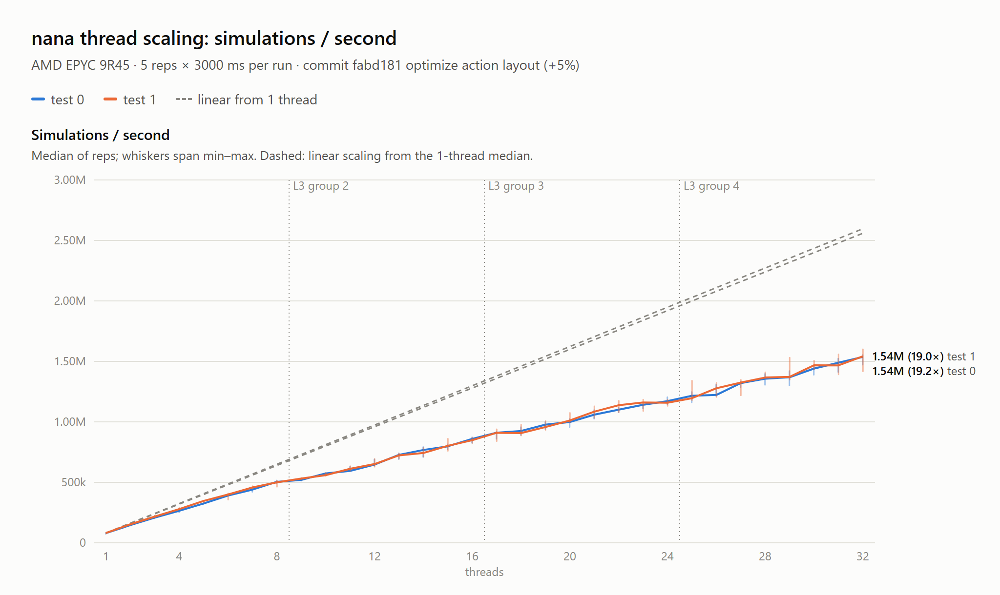
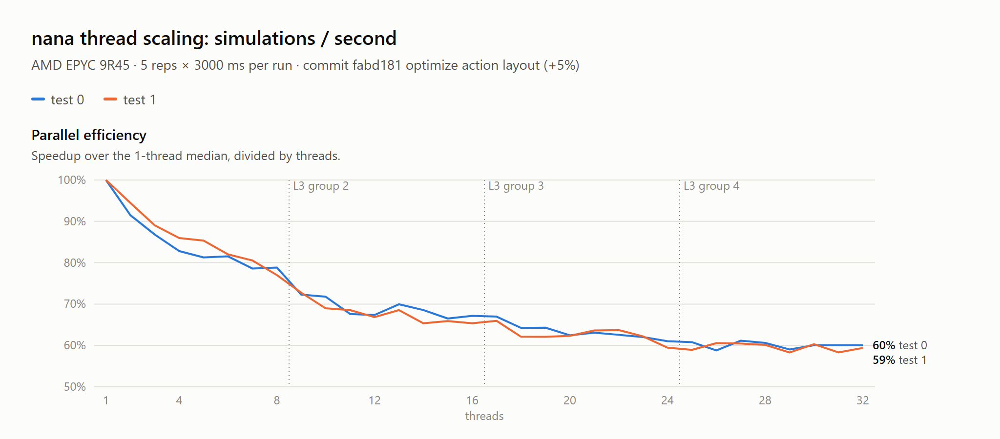
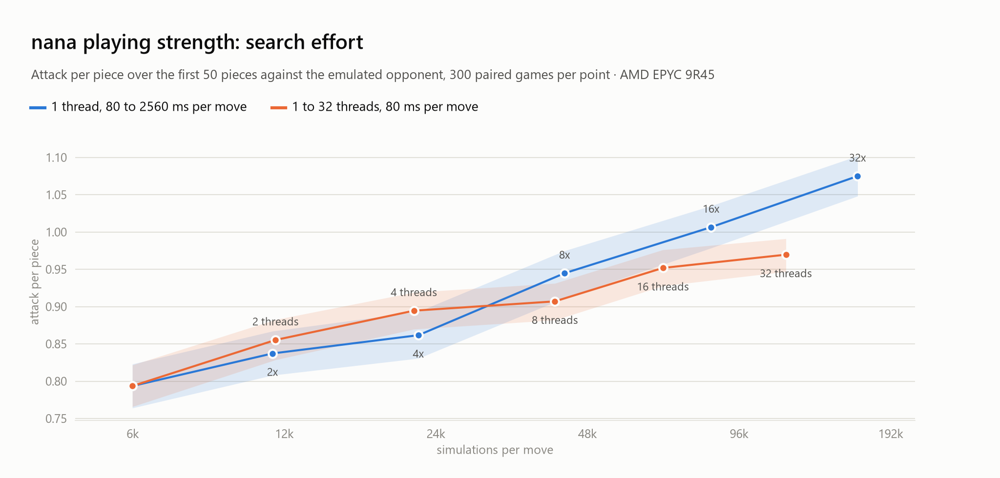
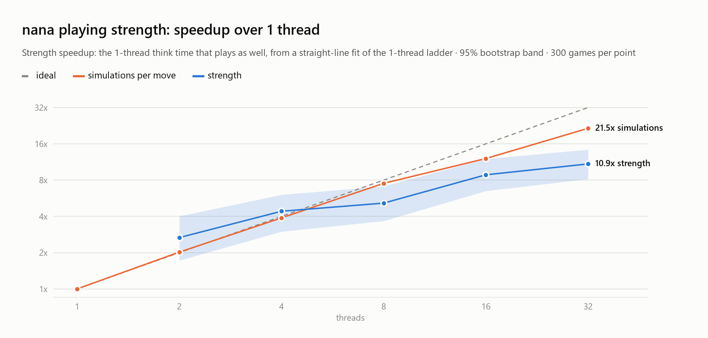

<p align="center">

</p>
<br>

# Nana

--------------------------

Nana is a parallel search program for two-player stacking games, such as Versus Tetris. 

Versus Tetris presents a variety of challenges that Nana chooses to approach explicitly, namely:

* Large branching factors
* Random chance
* Hidden information
* Efficient parallelisation
* Online any-time planning

The engine is designed to run on tournament hardware with an emphasis on high core counts and modern x86.


## How It Works

Nana at its core is based on the combination of two search techniques; Monte Carlo Tree Search (MCTS)[[1]](#1), and Transposition Driven Scheduling (TDS)[[2]](#2).

MCTS operates on the premise that we can generate an analysis of the game's local search space by phrasing states and actions as individual Multi Arm Bandit problems, and repeatedly performing Upper Confidence Bound selection of the actions which provide the best balance of exploitation and exploration. This method is also known as Upper Confidence bound applied to Trees, or UCT search.[[1]](#1)

Transposition Driven Scheduling is a load balancing technique that allows a program to efficiently scale to many threads while searching for solutions, and has historically been applied to puzzle games. It works by having the program globally agree to allocate ownership of certain gamestates to certain threads, based on the state's hash. This means that any thread can calculate who the owner is of a state that has never been seen before. 

### Work Requesting

One of the challenges specifically of searching Tetris that computing legal actions is very costly and highly non-uniform. In some states, it is a trivial computation while in others, it can take a long time. This means that existing TDS-MCTS methods such as those by Yoshizoe et al.[[3]](#3) encounter significant congestion issues when applied to this domain without dynamic load balancing.

To address this, Nana workers try to predict when they are at risk of running out of work, and pre-emptively request to borrow work from individual workers using a tuned heuristic taking into account load statistics and memory topology.

### Information State MCTS

Nana uses a special variant of MCTS that combines state abstraction with open-loop MCTS [[5]](#5) to games with randomness and hidden information. It is based on Information State MCTS [[6]](#6) which was designed for games with hidden information.

State abstraction allows Nana to combine search statistics on gamestates that look similar but differ superficially, while open-loop MCTS walks forward random simulations of the game without needing to know the underlying transition probabilities.

### Backpropagation Pruning

Nana's search parallelization is based on the optimized version of TDS-MCTS presented by Yang et al. 2020[[4]](#4), named MP-MCTS. By skipping redundant backpropagations, MP-MCTS significantly reduces root contention.

To adapt the MP-MCTS optimization correctly to ISMCTS, Nana resamples the environment dynamics based on the action table, and hands off the job once the trajectory diverges. This ensures the search doesn't degrade statistically, while eliminating unnecessary communication on the shared prefix.

### Opponent Modelling

To model garbage-trading dynamics and macro state, Nana uses an internal simulator that implements an Input-Output Hidden Markov Model (IOHMM). [[7]](#7) The IOHMM models the opponent as a probability distribution over macro states rather than a board that needs to be played out.

The default opponent model is the 8-state IOHMM trained on Nana's own play. In principle, it could be retuned or replaced with a custom model supporting the same input-output structure.

### Board Watching

If provided, Nana feeds opponent board information directly into the IOHMM using a logistic encoder.

Under TBP1 and protocols that don't support board watching, Nana uses the history of incoming garbage to reconstruct a belief about the opponent's boardstate.

## Scaling Experiments

We benchmarked simulations per second on a 32-core AMD EPYC 9R45 (SMT disabled), at every thread count from 1 to 32 on two positions. 

The engine achieves throughput efficiency of 80% on the first 8 cores, stabilizing at around 60% on 32 cores. The loss in efficiency is largely attributable to NUMA overhead. Reducing cross-chiplet communication remains an open problem.

<picture>
  <source media="(prefers-color-scheme: dark)" srcset="./docs/scaling-sims-dark.png">
  
</picture>

<picture>
  <source media="(prefers-color-scheme: dark)" srcset="./docs/scaling-eff-dark.png">
  
</picture>

To reproduce, run `scripts/speed_scaling.sh` on the machine (or through `scripts/run_ec2_bench.sh` with `SCRIPT=speed_scaling.sh`), then plot it with `node scripts/plot_speed.mjs <results dir>`.

### Playing Strength

We also measured end-to-end strength scaling by comparing more threads vs. more thinking time.  

Every configuration played 300 games of APM survival, and was scored by its attack per piece over the first 50 pieces.

Interestingly, over the regime we tested, a single thread given 80 to 2560 ms per move gained a consistent 6% APP per doubling of think time.

On 32 cores, Nana plays about as well as a single core given 11x thinking time.

<picture>
  <source media="(prefers-color-scheme: dark)" srcset="./docs/strength-effort-dark.png">
  
</picture>

<picture>
  <source media="(prefers-color-scheme: dark)" srcset="./docs/strength-speedup-dark.png">
  
</picture>

To reproduce, run `scripts/strength_batches.sh` through `scripts/run_ec2_bench.sh` (e.g. `SCRIPT=strength_batches.sh scripts/run_ec2_bench.sh <host> <key> <ref> MULTS=1,2,4,8,16,32 PAR_THREADS=2,4,8,16,32`), then `python scripts/strength_report.py <batch dirs>` for the numbers and `python scripts/plot_strength.py <batch dirs>` for these plots.


## Usage

Nana is built from C++ source with CMake (3.22+) and a C++23 compiler (Clang, GCC or MSVC). The build uses `-march=native`, so build on the machine that will run it. mimalloc is fetched automatically on configure, and the `ShakTrisLib` game library is a git submodule:

```
git clone --recurse-submodules <repo url>     # or: git submodule update --init
cmake -S . -B build -DCMAKE_BUILD_TYPE=Release
cmake --build build -j
```

On Windows with Visual Studio, `CMakeSettings.json` provides an `x64-Clang-Release` configuration (Ninja, clang-cl, `RelWithDebInfo`) that builds into `out/build/<config>/`. Always benchmark a Release build.

| Executable | Description |
|---|---|
| `tbp_tetris` | Backend for [TBP](https://github.com/tetris-bot-protocol) (JSON over stdin/stdout). |
| `nana_interactive` | Steps through the bot in a window and shows its search statistics. On Linux it needs X11, OpenGL and libpng. |
| `nana_emulate` | Plays emulated games (`EmulationGame`) against the HMM opponent model and reports attack per piece. Used by the tuner and the strength scripts. |
| `nana_bench` | Fixed-position search benchmark with profiling counters (built with `NANA_BENCH`). |
| `nana_speed` | Measures simulations per second. |
| `nana_msgbench` | Microbenchmark for message passing. |

CMake options (pass with `-D`):

* `NANA_GUI=OFF` skips `nana_interactive` to run headless.
* `NANA_MIMALLOC=OFF` uses the system allocator instead of mimalloc.
* `CMAKE_CXX_FLAGS="-DNANA_MPMCTS=0"` builds TDS-UCT instead of the default MP-MCTS.

Nana reads some environment variables:

* `NANA_CONFIG=path/to/config.json` loads eval and search weights (e.g. a tuner `release.json`). `nana_emulate --print-config` shows the format.
* `NANA_RULES=tetrio` plays with TETR.IO S1 rules.
* `NANA_MARKOV_OPPONENT=1` makes the search model the opponent with the Markov model.
* Search tuning knobs such as `NANA_LOAD_FAC` and `NANA_REWARD` are defined in `cpp/Tetris/bot/Search.cpp`.

## Tuning

Nana comes with a PSO-based autotuner. It tunes search hyperparameters and evaluation weights simultaneously.

The tuner needs a pre-compiled Release build of ``nana_emulate`` and Python with numpy. It runs from the repository root:

```
# check the setup first: a minute or two end to end
python -m tuner start smoke --nana out/build/<build>/cpp/nana_emulate.exe --cpus 0,2,4,6,8,10,12,14 --sims 64 --iterations 3 --particles 4 --games 4 --gate-games 16

# tune within a time budget: the tuner measures game times and picks the largest sims count that fits
python -m tuner start eval1 --nana out/build/<build>/cpp/nana_emulate.exe --cpus 0,2,4,6,8,10,12,14 --budget-hours 8

# see what a budget buys without tuning (resume then tunes)
python -m tuner start eval1 --nana ... --cpus ... --budget-hours 8 --plan-only

python -m tuner status eval1            # where the run is, from another terminal
python -m tuner resume eval1            # after Ctrl-C or a reboot
```

Give ``--cpus`` one logical cpu per physical core and keep the machine otherwise idle. The result is ``tuner/runs/<name>/release.json``, a config file Nana loads with ``NANA_CONFIG=path/to/release.json``. See ``tuner/README.md`` for how it works.

## References

1. https://en.wikipedia.org/wiki/Monte_Carlo_tree_search
2. https://en.wikipedia.org/wiki/Transposition-driven_scheduling
3. Scalable Distributed Monte-Carlo Tree Search, Yoshizoe et al. 2011 (https://www.graco.c.u-tokyo.ac.jp/~kaneko/papers/socs2011pmcts.pdf)
4. Practical Massively Parallel Monte-Carlo Tree Search Applied to Molecular Design, Yang et al. 2020 (https://arxiv.org/pdf/2006.10504)
5. Open Loop Optimistic Planning, Bubeck and Munos 2010 (https://chercheurs.lille.inria.fr/munos/papers/files/olop.pdf)
6. Information Set Monte Carlo Tree Search, Cowling et al. 2012 (https://eprints.whiterose.ac.uk/id/eprint/75048/1/CowlingPowleyWhitehouse2012.pdf)
7. An Input Output HMM Architecture, Bengio and Frasconi 1995 (https://www.iro.umontreal.ca/~lisa/bib/pub_subject/language/pointeurs/iohmm-nips7.pdf)