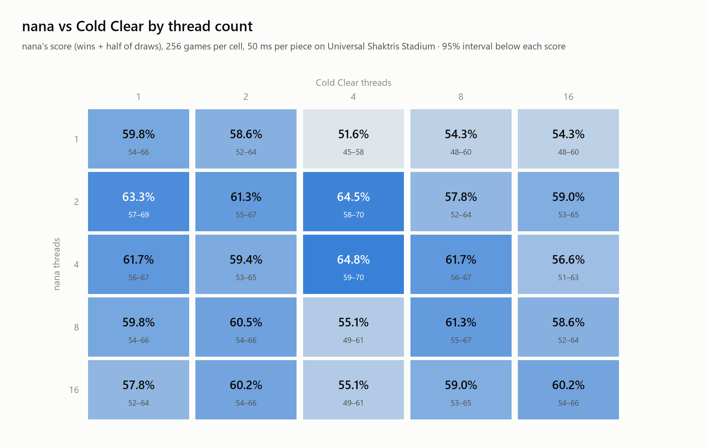

<p align="center">

</p>
<br>

# Nana

Nana is a parallel search program for two-player stacking games, such as Versus Tetris.

The engine is designed to run on tournament hardware with an emphasis on high core counts and modern x86.

## How It Works

Nana at its core is based on the combination of two search techniques; Monte Carlo Tree Search (MCTS)[[1]](#1)[[5]](#5)[[6]](#6), and Transposition Driven Scheduling (TDS)[[2]](#2)[[3]](#3)[[4]](#4). It marries these with an informative opponent model[[7]](#7), state abstraction[[8]](#8), and estimation over random outcomes[[9]](#9).

MCTS operates on the premise that we can generate an analysis of the game's local search space by phrasing states and actions as individual Multi Arm Bandit problems, and repeatedly performing Upper Confidence Bound selection of the actions which provide the best balance of exploitation and exploration. This method is also known as Upper Confidence bound applied to Trees, or UCT search.[[1]](#1)

Transposition Driven Scheduling is a load balancing technique that allows a program to efficiently scale to many threads while searching for solutions, and has historically been applied to puzzle games. It works by having the program globally agree to allocate ownership of certain gamestates to certain threads, based on the state's hash. This means that any thread can calculate who the owner is of a state that has never been seen before. 

For a more detailed overview of how Nana is implemented, including MCTS variations, multithreading architecture, and opponent conditioning, please see `docs/README.md`.

## Scaling Experiments

We benchmarked simulations per second on a 32-core AMD EPYC 9R45 (SMT disabled), at every thread count from 1 to 32 on two positions. 

The engine achieves throughput efficiency of 80% on the first 8 cores, stabilizing at around 60% on 32 cores. The loss in efficiency is largely attributable to NUMA overhead. Reducing cross-chiplet communication remains an open problem.

<picture>
  <source media="(prefers-color-scheme: dark)" srcset="./docs/scaling-sims-dark.png">
  
</picture>

<picture>
  <source media="(prefers-color-scheme: dark)" srcset="./docs/scaling-eff-dark.png">
  
</picture>

### Playing Strength

We also measured end-to-end strength scaling by comparing more threads vs. more thinking time.  

Every configuration played 300 games of APM survival, and was scored by its attack per piece over the first 50 pieces.

Interestingly, over the regime we tested, a single thread given 80 to 2560 ms per move gained a consistent 6% APP per doubling of think time.

On 32 cores, Nana plays about as well as a single core given 11x thinking time.

<picture>
  <source media="(prefers-color-scheme: dark)" srcset="./docs/strength-effort-dark.png">
  
</picture>

<picture>
  <source media="(prefers-color-scheme: dark)" srcset="./docs/strength-speedup-dark.png">
  
</picture>

### Winrate Experiments

We played Nana against [Cold Clear](https://github.com/MinusKelvin/cold-clear) on the Universal Shaktris Stadium under TETR.IO season 1 rules, using Seppel3210's TETR.IO-tuned weights for Cold Clear.

Over 6,400 games, Nana had 3,779 wins to 2,621 losses (59.0% winrate), with a 95% CI of 57.8-60.2%.

Both programs were given 50ms time control and varying thread counts from 1 to 16. Nana was configured using defaults from commit `00005d0`: Expectimax-UCT with rank-1 opponent conditioning.

<picture>
  <source media="(prefers-color-scheme: dark)" srcset="./docs/cc-matrix-dark.png">
  
</picture>

Each cell's 95% interval is about ±6 points, so at this time control, more games would likely need to be run to determine a clear thread-scaling pattern for either program. 

## Usage

Experiment, training, and cloud helpers are listed in the [scripts guide](scripts/README.md).

Nana is built from C++ source with CMake (3.22+) and a C++23 compiler (Clang, GCC or MSVC). By default the build uses `-march=native`, so build on the machine that will run it (see [Portable builds](#portable-builds) for binaries that run elsewhere). mimalloc is fetched automatically on configure, and the `ShakTrisLib` game library is a git submodule:

```
git clone --recurse-submodules <repo url>     # or: git submodule update --init
cmake -S . -B build -DCMAKE_BUILD_TYPE=Release
cmake --build build -j
```

On Windows with Visual Studio, `CMakeSettings.json` provides an `x64-Clang-Release` configuration (Ninja, clang-cl, `RelWithDebInfo`) that builds into `out/build/<config>/`. Always benchmark a Release build.

| Executable | Description |
|---|---|
| `nana_tbp` | Backend for [TBP](https://github.com/tetris-bot-protocol) (JSON over stdin/stdout). |
| `nana_interactive` | Steps through the bot in a window and shows its search statistics. On Linux it needs X11, OpenGL and libpng. |
| `nana_emulate` | Plays emulated games (`EmulationGame`) against the HMM opponent model and reports attack per piece. Used by the tuner and the strength scripts. |
| `nana_bench` | Fixed-position search benchmark with profiling counters (built with `NANA_BENCH`). |
| `nana_speed` | Measures simulations per second. |
| `nana_msgbench` | Microbenchmark for message passing. |

CMake options (pass with `-D`):

* `NANA_GUI=OFF` skips `nana_interactive` to run headless.
* `NANA_MIMALLOC=OFF` uses the system allocator instead of mimalloc.
* `CMAKE_CXX_FLAGS="-DNANA_MPMCTS=0"` builds TDS-UCT instead of the default MP-MCTS.
* `NANA_MARCH=<level>` sets the `-march` of every executable except a launcher-built `nana_tbp` (default `native`).
* `NANA_VARIANTS="<level>;<level>;..."` builds `nana_tbp` for several ISA levels (see below).

### Portable Build

Distributed via Github releases, there are some portable Nana pre-compiled binaries for Windows and Linux.

Each release contains multiple binaries targeting different hardware. `nana_tbp` uses the optimal version of Nana based on your detected hardware.

`nana_tbp` reads `nana.json` beside the executable, which can adjust Nana's default settings. It looks like this:

```json
{
  "rules": "tetrio",
  "threads": 3,
  "pin_layout": "compact"
}
```

Some of these, such as `threads` can be overridden by a TBP2 frontend such as [Universal Shaktris Stadium](https://github.com/shakkar23/Universal-Shaktris-Stadium).

## Tuning

Nana comes with a autotuner supporting PSO, CMA-ES, and SPSA. It tunes a subset of hyperparameters such as evaluation weights or search parameters based on a provided .json file.

The tuner needs a pre-compiled Release build of ``nana_emulate`` and Python with numpy. To tune against winrate outcomes (such as for opponent conditioning), it also needs ``Universal-Shaktris-Stadium``.

```
# check the setup first: a minute or two end to end
python -m tuner start smoke --nana out/build/<build>/cpp/nana_emulate.exe --cpus 0,2,4,6,8,10,12,14 --sims 64 --iterations 3 --particles 4 --games 4 --gate-games 16

# tune within a time budget: the tuner measures game times and picks the largest sims count that fits
python -m tuner start eval1 --nana out/build/<build>/cpp/nana_emulate.exe --cpus 0,2,4,6,8,10,12,14 --budget-hours 8

# tune sims/s with the search parameter space and fewer games (4 per evaluation)
python -m tuner start speed1 --nana ... --cpus ... --sims 8192 --objective sims-per-second

# see what a budget buys without tuning (resume then tunes)
python -m tuner start eval1 --nana ... --cpus ... --budget-hours 8 --plan-only

python -m tuner status eval1            # where the run is, from another terminal
python -m tuner resume eval1            # after Ctrl-C or a reboot
```

## References

1. https://en.wikipedia.org/wiki/Monte_Carlo_tree_search
2. https://en.wikipedia.org/wiki/Transposition-driven_scheduling
3. Scalable Distributed Monte-Carlo Tree Search, Yoshizoe et al. 2011 (https://www.graco.c.u-tokyo.ac.jp/~kaneko/papers/socs2011pmcts.pdf)
4. Practical Massively Parallel Monte-Carlo Tree Search Applied to Molecular Design, Yang et al. 2020 (https://arxiv.org/pdf/2006.10504)
5. Open Loop Optimistic Planning, Bubeck and Munos 2010 (https://chercheurs.lille.inria.fr/munos/papers/files/olop.pdf)
6. Information Set Monte Carlo Tree Search, Cowling et al. 2012 (https://eprints.whiterose.ac.uk/id/eprint/75048/1/CowlingPowleyWhitehouse2012.pdf)
7. An Input Output HMM Architecture, Bengio and Frasconi 1995 (https://www.iro.umontreal.ca/~lisa/bib/pub_subject/language/pointeurs/iohmm-nips7.pdf)
8. State Aggregation in Monte Carlo Tree Search, Hostetler et al. 2014 (https://ojs.aaai.org/index.php/AAAI/article/view/9066)
9. Reinforcement Learning via AIXI Approximation, Veness et al. 2010 (https://arxiv.org/html/1007.2049v1)
